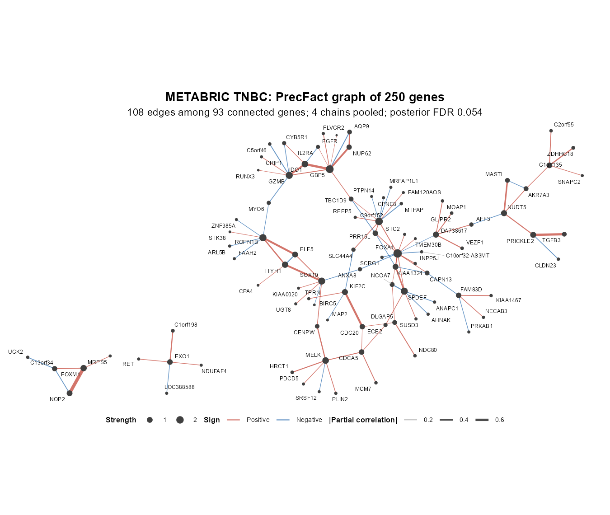
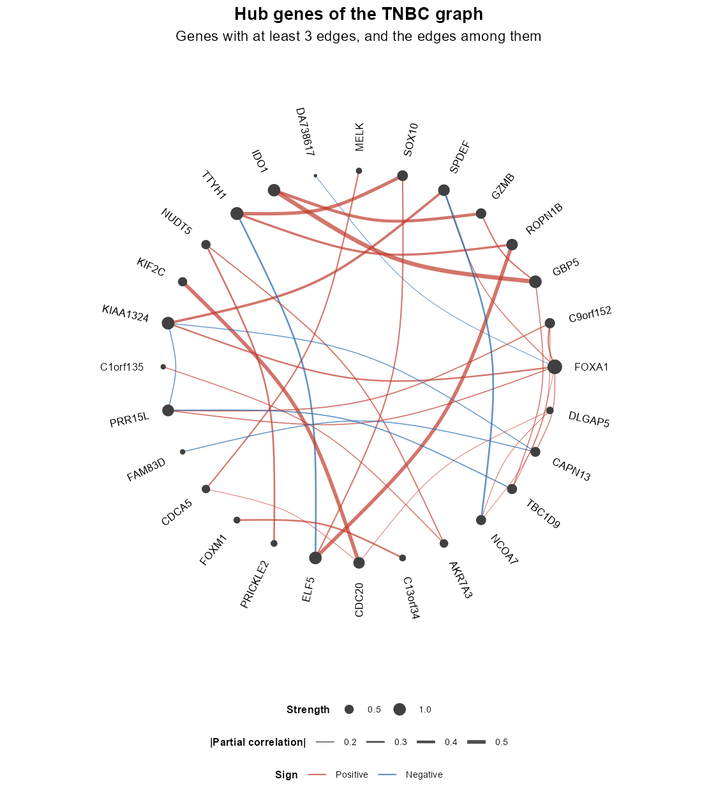
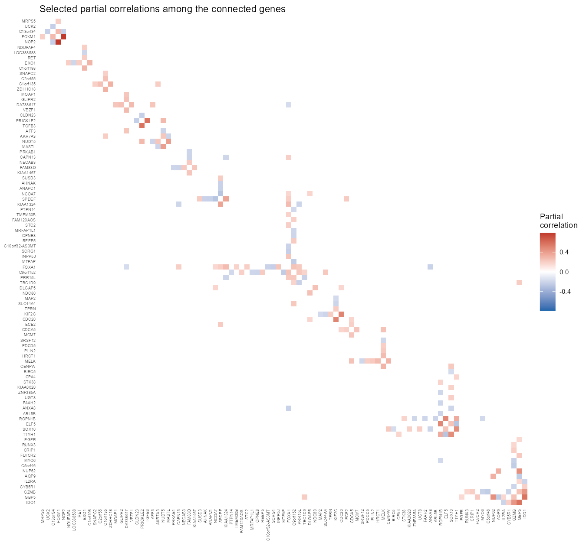
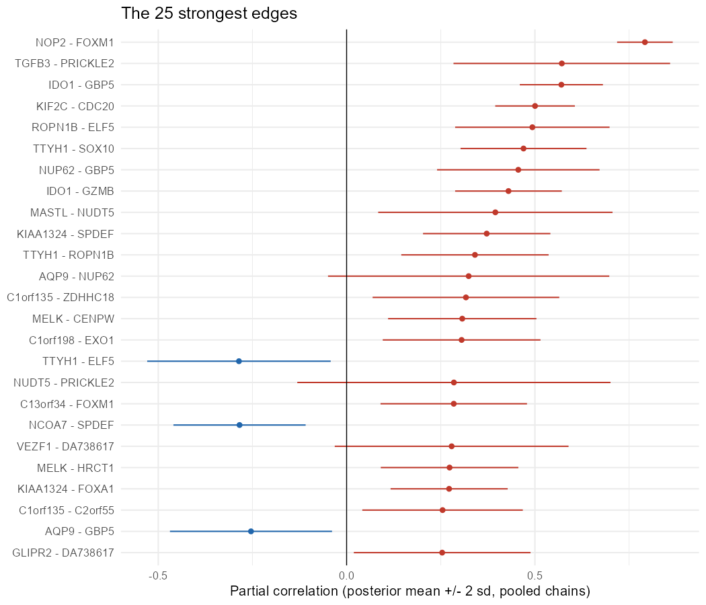
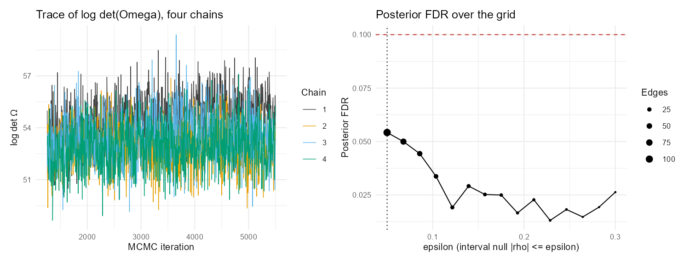
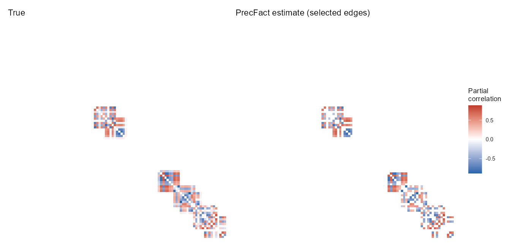
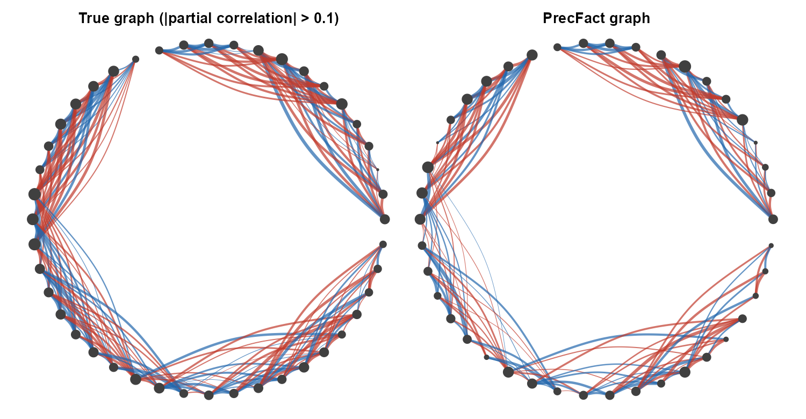

# PrecFact

**Bayesian precision factor analysis for Gaussian graphical models.**

PrecFact estimates a high-dimensional Gaussian precision matrix and its conditional
independence graph with the method of

> Chandra NK, Müller P, Sarkar A (2026). Bayesian Scalable Precision Factor Analysis for
> Gaussian Graphical Models. *Bayesian Analysis*, 21(1), 75–103.
> [doi:10.1214/24-BA1461](https://doi.org/10.1214/24-BA1461)

The precision matrix is written as a low-rank plus diagonal matrix,
Ω = ΛΛᵀ + Δ, with a d × q loading matrix Λ under a Dirichlet–Laplace prior and a diagonal
Δ whose entries follow a Dirichlet process. A latent variable representation of this
decomposition gives a Gibbs sampler whose cost grows linearly in the number of factors q,
and the graph is selected by controlling the posterior false discovery rate (FDR).

This repository is a portable version of the code released with the article. The
original package needed GSL, mlpack and OpenMP installed on the system and was tested only
on Ubuntu and macOS. This version needs only R, a C++ compiler and CRAN packages, and
builds on Windows, macOS and Linux. The differences are listed in
[Changes from the original code](#changes-from-the-original-code).

## Contents

- [Installation](#installation)
- [Quick start](#quick-start)
- [The model and the graph selection rule](#the-model-and-the-graph-selection-rule)
- [Example: a TNBC gene network](#example-a-tnbc-gene-network)
- [Example: simulated data with a known graph](#example-simulated-data-with-a-known-graph)
- [Using several chains](#using-several-chains)
- [Functions](#functions)
- [Changes from the original code](#changes-from-the-original-code)
- [Citation](#citation)
- [License](#license)

## Installation

```r
# install.packages("remotes")
remotes::install_github("sagnikbhadury/PrecFact")
```

The package compiles C++ code, so it needs Rtools on Windows, the Xcode command line
tools on macOS (`xcode-select --install`), or `r-base-dev` (or the equivalent) on Linux.
It depends only on Rcpp, RcppArmadillo, irlba, ggplot2, ggraph and igraph.

## Quick start

```r
library(PrecFact)

sim <- simulate_precfact(n = 200, d = 50, q = 5, seed = 1)   # data with a known graph
fit <- precfact(sim$y, chains = 2, seed = 1)                 # fit and select the graph
fit                                                          # short report
summary(fit)                                                 # hubs and strongest edges
precfact_edges(fit)                                          # edge table
plot_network(fit)                                            # network figure
heatplot(fit)                                                # partial correlation heat map
plot_trace(fit)                                              # convergence check
```

`precfact()` centres and scales the columns, chooses q from a PCA of the data, runs the
Gibbs sampler, discards the burn-in and selects the graph. Its defaults are the settings
used for every analysis in the article: 5,500 iterations with 1,250 discarded and a
thinning interval of 5, Dirichlet–Laplace parameters a = b = 0.5, gamma hyperparameters
0.1, q chosen to cover 95% of the inverse singular values, and posterior FDR 0.10.

The result holds the posterior mean of Ω (`fit$Omega`), the posterior mean and standard
deviation of the partial correlations (`fit$pcor`, `fit$pcor_sd`), the selected graph
(`fit$graph`), the posterior edge probabilities (`fit$edge_prob`) and the posterior FDR of
the graph (`fit$pFDR`).

## The model and the graph selection rule

For observations yᵢ ~ N_d(0, Ω⁻¹), i = 1, …, n, the article shows (Proposition 1) that
Ω = ΛΛᵀ + Δ admits the latent representation

yᵢ = −Δ⁻¹Λ(I_q + ΛᵀΔ⁻¹Λ)⁻¹uᵢ + vᵢ,

with uᵢ and vᵢ jointly Gaussian. Given Λ and Δ, the latent uᵢ and vᵢ are drawn directly;
given them, each row of Λ has a Gaussian full conditional. With the Dirichlet–Laplace
scales and the Dirichlet process clustering of the diagonal of Δ, every step of the
sampler is a draw from a standard distribution, and positive definiteness of Ω holds by
construction.

Continuous shrinkage priors give no exact zeros, so edges are chosen by testing the
interval nulls H₀ᵢⱼ: |ρᵢⱼ| ≤ ε, where ρ is the partial correlation matrix. The edge (i, j)
is declared when its posterior probability Π(|ρᵢⱼ| > ε | y) exceeds β, and the posterior
FDR of these decisions is computed for a grid of ε. Every declared edge has posterior
probability above β, so the posterior FDR is at most 1 − β; the default β = 1 − α = 0.9
controls it at α = 0.10, as in the article. Among the values of ε that keep the FDR below
α, the one with the largest FDR (the least conservative) is used. `select_graph()` repeats
the selection with other settings without re-running the sampler.

## Example: a TNBC gene network

This example uses `tnbc_metabric`, the processed METABRIC triple-negative breast cancer
panel (299 patients × 1000 genes) of the
[GGMsubho](https://github.com/sagnikbhadury/GGMsubho) package. It contains log mRNA
Z-scores of the genes most differentially expressed by triple-negative status; see
`?GGMsubho::tnbc_metabric` for the processing and the publications to cite for the data
(Curtis et al. 2012; Pereira et al. 2016; Rueda et al. 2019; and the cBioPortal).

The analysis uses the first 250 genes of the panel, so that the sample size exceeds the
dimension (n = 299 > d = 250), as in the gene expression application of the article (d =
544, n = 653).

### Load the data

Either install GGMsubho, or download only the data file:

```r
# Option 1: install GGMsubho
# remotes::install_github("sagnikbhadury/GGMsubho")
tnbc <- GGMsubho::tnbc_metabric

# Option 2: download the data file only
tmp <- tempfile(fileext = ".rda")
download.file("https://github.com/sagnikbhadury/GGMsubho/raw/main/data/tnbc_metabric.rda",
              tmp, mode = "wb")
load(tmp)
tnbc <- tnbc_metabric

x <- tnbc[, 1:250]
dim(x)
#> [1] 299 250
```

### Fit the model

```r
library(PrecFact)
fit <- precfact(x, chains = 4, seed = 1)
fit
#> Bayesian precision factor model (Chandra, Mueller and Sarkar 2026)
#>   n = 299 observations, d = 250 variables, q = 23 factors
#>   4 chain(s) of 5500 MCMC iterations, 1250 burn-in, thinning 5; 136.4 seconds
#>   Graph: 108 edges of 31125 (0.35%); posterior FDR 0.054 at epsilon = 0.050
#>   Single chains select 381/290/62/394 edges; each holds 19%-81% of the pooled graph's edges
```

The four chains together took a little over two minutes on a desktop computer. The
selected graph has 108 edges among 93 genes (71 positive and 37 negative partial
correlations); 157 genes have no edge.

```r
summary(fit, top = 10)
#> Most connected variables:
#>      node degree strength
#>     FOXA1     13    2.746
#>  C9orf152     10    2.109
#>      GBP5      8    2.266
#>    ROPN1B      7    1.791
#>      GZMB      7    1.719
#>     SPDEF      7    1.717
#>     SOX10      7    1.687
#>      MELK      6    1.442
#>  DA738617      5    1.172
#>      IDO1      4    1.401
#>
#> Strongest edges:
#>      from       to partial_correlation     sd edge_prob
#>      NOP2    FOXM1               0.792 0.0369     1.000
#>     TGFB3 PRICKLE2               0.571 0.1438     0.992
#>      IDO1     GBP5               0.570 0.0552     1.000
#>     KIF2C    CDC20               0.500 0.0529     1.000
#>    ROPN1B     ELF5               0.493 0.1025     1.000
#>     TTYH1    SOX10               0.470 0.0836     1.000
#>     NUP62     GBP5               0.456 0.1078     1.000
#>      IDO1     GZMB               0.430 0.0708     1.000
#>     MASTL    NUDT5               0.395 0.1556     0.991
#>  KIAA1324    SPDEF               0.372 0.0845     1.000
```

`strength` is the sum of the absolute partial correlations of a gene's edges, and
`edge_prob` is the posterior probability that the absolute partial correlation exceeds
the selected ε.

### The network

`plot_network()` draws the graph. Edge colour gives the sign of the posterior mean partial
correlation, edge width its magnitude, and node size the gene's strength. For larger
graphs a force-directed layout such as `"stress"` is easier to read than the default
circle:

```r
plot_network(fit, layout = "stress", label_size = 2.1,
             title = "METABRIC TNBC: PrecFact graph of 250 genes")
```

<p align="center"></p>

The graph separates into a few connected modules: one around FOXA1, SPDEF, KIAA1324 and
C9orf152; one around ROPN1B, ELF5, SOX10 and TTYH1; one around IDO1, GBP5, GZMB and IL2RA;
and one around KIF2C, CDC20, MELK and CDCA5, with smaller components such as
FOXM1–NOP2–C13orf34.

Restricting to the hub genes (here, at least three edges) with the `nodes` argument:

```r
hubs <- top_hubs(fit)
hub_genes <- hubs$node[hubs$degree >= 3]
plot_network(fit, nodes = hub_genes, title = "Hub genes of the TNBC graph")
```

<p align="center"></p>

### Partial correlations

`heatplot()` shows the selected partial correlation matrix, here for the connected genes
ordered by hierarchical clustering:

```r
conn <- top_hubs(fit)$node
ord <- hclust(as.dist(1 - abs(graph_pcor(fit, conn))), method = "average")$order
heatplot(fit, nodes = conn[ord])
```

<p align="center"></p>

The posterior standard deviations in `precfact_edges()` give uncertainty for each edge:

```r
head(precfact_edges(fit), 25)
```

<p align="center"></p>

### Diagnostics

`plot_trace()` shows log det Ω for every kept draw of every chain, and `fit$fdr_table`
gives the number of edges and the posterior FDR for each ε of the grid:

```r
plot_trace(fit)
fit$fdr_table
```

<p align="center"></p>

The traces of log det Ω overlap, but this global summary hides a difference in the graphs:
run alone, chains 1, 2 and 4 select 290 to 394 edges, while chain 3 selects 62. The pooled
graph keeps the edges supported across chains: chains 1, 2 and 4 each contain about 80%
of its 108 edges, and chain 3 contains 19%. See [Using several chains](#using-several-chains).

The edge and hub tables of this analysis can be written with
`write.csv(precfact_edges(fit), "tnbc_edges.csv")` and `write.csv(top_hubs(fit), ...)`.
The scripts that produced every number and figure in this section are
`tools/tnbc_analysis.R` and `tools/make_readme_figures.R`.

## Example: simulated data with a known graph

`simulate_precfact()` draws data whose precision matrix is ΛΛᵀ + I with a sparse Λ, the
design of the example in the original package. With n = 200 and d = 100:

```r
sim <- simulate_precfact(n = 200, d = 100, q = 8, pr = 0.1, val = 2.5, seed = 1)
fit_sim <- precfact(sim$y, chains = 2, seed = 1)
fit_sim
#>   n = 200 observations, d = 100 variables, q = 24 factors
#>   2 chain(s) of 5500 MCMC iterations, 1250 burn-in, thinning 5; 23.2 seconds
#>   Graph: 152 edges of 4950 (3.07%); posterior FDR 0.009 at epsilon = 0.229
#>   Single chains select 161/131 edges; each holds 86%-100% of the pooled graph's edges
```

Counting an edge as true when its absolute partial correlation exceeds 0.1, as the article
does for its plots, the true graph has 217 edges. PrecFact selects 152, all of them true
(sensitivity 0.70, specificity 1.00), and the posterior mean partial correlations have
correlation 0.93 with the true ones.

```r
truth <- sim$pcor; diag(truth) <- NA; truth[truth == 0] <- NA
est <- graph_pcor(fit_sim); diag(est) <- NA; est[est == 0] <- NA
heatplot(truth, diverging = TRUE)
heatplot(est, diverging = TRUE)
```

<p align="center"></p>

```r
tg <- sim$pcor; tg[abs(tg) < 0.1] <- 0
plot_network(tg, show_labels = FALSE, title = "True graph")
plot_network(fit_sim, show_labels = FALSE, title = "PrecFact graph")
```

<p align="center"></p>

## Using several chains

On the simulated data, independent chains give nearly the same graph. On the TNBC genes
they do not: the chains reach similar values of log det Ω, but single chains select from
62 to 394 edges, and running each chain for 30,000 iterations did not bring them closer.
Changing the Dirichlet–Laplace parameter a, fixing a smaller q, or letting the diagonal
entries of Δ differ (`alldiff = TRUE`) did not remove the disagreement either. A graph
from a single chain can therefore depend on the seed.

With `chains = k`, `precfact()` runs k chains from the same initial value and pools their
post-burn-in draws for every summary and for the graph. A pair of genes then needs high
posterior probability across chains to be selected. `fit$chain_agreement` reports, for each
chain, the number of edges it selects alone, the share of the pooled graph's edges it
contains, and the correlation of its partial correlations with those of the other chains.
For real data we suggest at least four chains, and comparing `fit$chain_agreement` across
seeds. In our checks the agreement between chains was lower when d > n (d = 200, n = 100)
than when n > d.

## Functions

| Task | Functions |
|---|---|
| Fit and select the graph | `precfact()` |
| Re-select the graph with other α, β or ε | `select_graph()` (needs `keep_samples = TRUE`) |
| Results | `print()`, `summary()`, `precfact_edges()`, `top_hubs()`, `graph_pcor()` |
| Figures | `plot_network()`, `heatplot()`, `plot_trace()`, `network_data()` |
| Low-level interface of the original code | `pca_prec()`, `prec_est()`, `fact_prec_processing()` |
| Low-rank plus diagonal algebra | `fast_fact_inv()`, `fast_fact_det()` |
| Simulation | `simulate_precfact()` |

Every function has a help page with examples, and `vignette("PrecFact")` walks through a
small simulated example.

## Changes from the original code

The Gibbs sampler is the one of the article and of the original C++ code. The changes are:

- **Portability.** The GSL calls (log-Pochhammer, powers, comparisons) are replaced by
  their R and C++ equivalents. The mlpack k-means used once to initialise the clustering
  of the diagonal of Δ (two clusters on the column sums of squares) is replaced by a
  two-cluster one-dimensional k-means. RcppDist, RcppEnsmallen, RcppProgress and OpenMP,
  which the sampler did not use, are removed, as are unused functions. The package now
  needs only Rcpp and RcppArmadillo to compile.
- **Reproducibility.** All random numbers come from R's generator, so `set.seed()` (or
  `seed =`) reproduces a run exactly. The original initialisation used mlpack's own random
  number generator.
- **A working wrapper.** `gaussian_precision_factor()` of the original code called the
  sampler with arguments that did not match its signature and ignored its `alpha` and
  `beta` arguments. It is replaced by `precfact()`.
- **Memory.** The original post-processing stacked a d × d × S array of draws (about 7 GB
  for d = 1000 and the default run). The draws are now processed one at a time, in C++.
- **Selection threshold.** The default β is 1 − α = 0.9, which bounds the posterior FDR
  by α as in Section 2.4 of the article. The original default β = 0.7 bounds it only by
  0.3, and on the TNBC genes no ε in the grid then reaches FDR 0.10; `beta = 0.7`
  reproduces the original behaviour.
- **Defaults.** The defaults of `precfact()` follow the article (b = 0.5, q from 95% of
  the inverse singular values) rather than the original vignette (b = 2, 90%).
- **Additions.** Several chains with pooled draws, the posterior mean and standard
  deviation of the partial correlations, re-selection without re-sampling, edge and hub
  tables, network figures (replacing `derive_graph()`, which needed the colortools package,
  no longer on CRAN), a trace plot, a simulator, tests and a vignette.

## Citation

If you use PrecFact, please cite the article:

```bibtex
@article{chandra2026precfact,
  title   = {Bayesian Scalable Precision Factor Analysis for Gaussian Graphical Models},
  author  = {Chandra, Noirrit Kiran and M{\"u}ller, Peter and Sarkar, Abhra},
  journal = {Bayesian Analysis},
  year    = {2026},
  volume  = {21},
  number  = {1},
  pages   = {75--103},
  doi     = {10.1214/24-BA1461}
}
```

`citation("PrecFact")` prints the same reference. If you use the TNBC panel, also cite
the data publications listed in `?GGMsubho::tnbc_metabric`.

## License

GPL (>= 3). The original PrecFact code is by Noirrit Kiran Chandra. The generalized
inverse Gaussian generator in `src/gg_model.cpp` is adapted from the GIGrvg package by
Josef Leydold and Wolfgang Hörmann (GPL >= 2).
